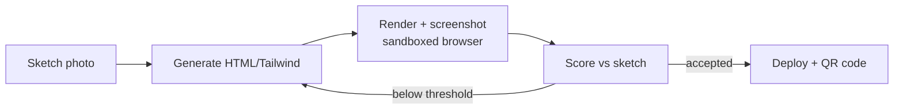

# SketchOps

An autonomous sketch-to-app agent with eval-gated deployment and production observability.

Photograph a hand-drawn app screen and get a live web app in minutes. An AI agent writes the code, renders it, compares the result to your sketch, and fixes its own mistakes. An MLOps pipeline around the agent traces every step, blocks quality regressions in CI, and monitors the system in production.

## How it works

1. User uploads a photo of a hand-drawn screen.
2. A vision LLM reads the sketch and generates HTML/Tailwind code.
3. The code is rendered in a sandboxed headless browser and a screenshot is taken.
4. The screenshot is scored against the sketch. If below the threshold, the agent revises its own code.
5. The accepted app is deployed live, and a QR code opens it on any phone.

## MLOps Stack

| Area | Tool | Purpose |
|---|---|---|
| Sketch understanding and code generation | Gemini Flash | Reads the sketch and generates HTML/Tailwind code |
| Fallback and judge | Llama via Groq | Fallback generator and LLM-as-judge |
| Visual similarity | CLIP / SigLIP | Screenshot-vs-sketch visual similarity score |
| Cloud | Azure Container Apps, Container Registry, Blob Storage | Hosting, image storage, and file/app storage |
| Containers | Docker, Docker Compose | Containerization, with a separate sandbox container for generated code |
| Agent | LangGraph, Playwright | Agent loop orchestration and headless browser rendering |
| Tracing and prompt versioning | Langfuse (self-hosted) | Step-level traces and versioned prompts |
| Experiment tracking | MLflow | Compare prompts, models, and loop settings |
| Data versioning | DVC | Versioning the 50-sketch eval set |
| CI/CD | GitHub Actions | Pipeline with evaluation gate |
| Monitoring and alerting | Prometheus, Grafana | Live metrics, dashboards, and alerts |
| Serving and UI | FastAPI, Streamlit | Backend API and user interface |

## Team

- **Maaham Rizwan** 
- **Maheen Kamran** 

FAST NUCES Lahore